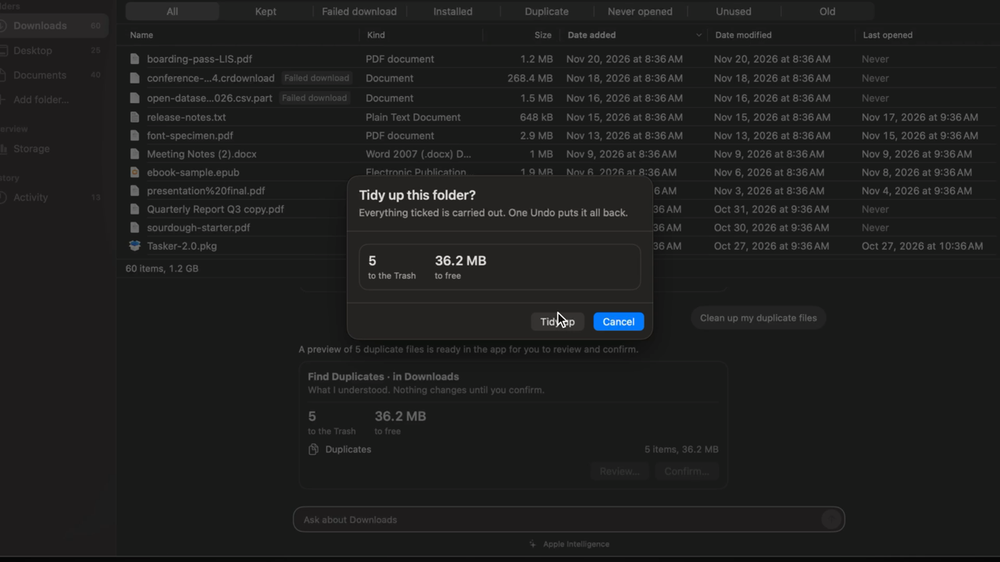

# Smart OS File Store

A Mac file browser that cleans up after itself, with Apple Intelligence built in.

**[▶ Demo Video](https://youtu.be/WS7LjVyksO4)**

[](https://youtu.be/WS7LjVyksO4)

## Features

**Apple Intelligence chat.** Ask about your files in plain English: what is taking space, which files are duplicates, which installers you have already used. The model runs on your Mac and can run the app's cleaning tools, but it only proposes a cleanup. Nothing changes until you confirm it. The numbers and file lists come from the app's own code, not from the model.

**Duplicate detection.** Files are compared by content with SHA-256 hashes (CryptoKit). Only files that share a size are read, in chunks, and hashes are cached, so a second scan reads nothing it has seen before.

**Tidy Now.** One click checks a folder for duplicates, used installers, unpacked zips, failed downloads, messy names and old files, and shows every file in a preview before anything moves.

**Your folders.** Downloads, Desktop, Documents and any folder you add, each with its own cleanup rules.

**Storage overview.** See what is taking space by folder and kind, what each cleanup would get back, and how much the app has moved to the Trash over time.

**Activity log and undo.** Every file action (trash, rename, move, undo) is recorded in a local SQLite database before and after it happens, so the history survives a crash. Any cleanup can be undone. Files only ever go to the Trash, never deleted for good.

**Tested.** Unit tests with Swift Testing cover the core engine, and GitHub Actions builds and tests every push.

**Measured chat.** About 140 labelled requests, asks the app cannot do and hostile file names run through the real chat on the on-device model, scored with Apple's Evaluations framework. Each run writes a report to [docs/evals](docs/evals/README.md).

## Evals

The chat's evals need a Mac with Apple Intelligence turned on. One command runs them (about twenty minutes) and writes `docs/evals/<date>-prompts-v<N>.md`, with every metric and every miss, and adds a row to [docs/evals/README.md](docs/evals/README.md):

```bash
scripts/run-evals.sh
```

`scripts/run-evals.sh -only-testing:ChatEvals` runs only the scored set. CI runs the same harness with a scripted model instead, so the metric code is tested on every push. How the evals work and the targets they are held to: [docs/decisions/0033-chat-evals.md](docs/decisions/0033-chat-evals.md).

Built with Swift 6, SwiftUI, SQLite and Foundation Models. Development notes are in [docs/development.md](docs/development.md).
